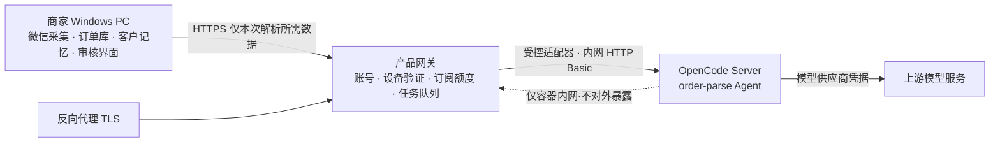

# 云端网关与 OpenCode 执行后端：部署、运维与验收

适用范围：微信采集在商家 Windows 本机运行；原始消息、客户记忆、商品资料、订单与审核界面**全部在本地**；云端只部署两个应用服务——产品网关与 OpenCode 执行后端。

本文档描述的部署**尚未在真实 OpenCode 上验证**。请先读 [`opencode-verification.md`](opencode-verification.md) 的“尚未验证”清单。

---

## 1. 架构与边界



| 组件 | 位置 | 职责 |
| --- | --- | --- |
| 商家软件 | 商家 PC | 采集、订单库、客户记忆、界面、导出。**离线可完整使用。** |
| 产品网关 | 云端 | 账号与网页验证、设备、订阅额度、任务队列、OpenCode 适配 |
| OpenCode Server | 云端内网 | 运行受限的 `order-parse` Agent |
| 反向代理 | 云端 | HTTPS 入口，唯一对公网开放的组件 |

**网关只返回解析建议**，不能直接修改客户本地正式订单。金额计算、规则校验、订单确认和最终写入仍由 `orders.py` 这一现有业务层执行。

---

## 2. 已核实的 OpenCode 事实（实施依据）

以下结论来自 OpenCode 官方文档与发布的 OpenAPI 规范，不是假设。

| 事实 | 结论 | 来源 |
| --- | --- | --- |
| 固定版本 | **`opencode-ai@1.18.32`**（npm `latest`，GitHub `v1.18.32`）。仓库为 `anomalyco/opencode`，包名为 `opencode-ai`，裸包名 `opencode` 不存在。 | npm registry / GitHub |
| 启动 | `opencode serve [--port N] [--hostname H] [--cors O]`。CLI 端口默认 `0`，服务端先试 4096 再退回随机空闲端口，**生产必须显式传 `--port`**。 | docs/server |
| 服务端认证 | 仅 `OPENCODE_SERVER_PASSWORD`（非空）开启 HTTP Basic；用户名默认 `opencode`，可用 `OPENCODE_SERVER_USERNAME` 覆盖。**默认关闭**，无 `--auth` 参数。 | docs/server |
| 健康检查 | `GET /global/health` → `{"healthy": bool, "version": str}` | docs/server |
| 会话 API | `POST /session`、`POST /session/{id}/message`、`POST /session/{id}/abort`、`DELETE /session/{id}`、`GET /session/{id}/message` | docs/server |
| OpenAPI 规范 | `GET /doc`（本版本返回原始 JSON） | docs/server |
| **OpenAI 兼容端点** | **不存在。** v1（162 个 path）与 v2（113 个 path）两份已发布 OpenAPI 规范中，`chat/completions`、`/v1/`、`completions` 均为 0 命中。本项目因此直接对接会话 API，不假设 `/v1/chat/completions` 可用。 | openapi.json 全量检索 |
| Agent 目录 | 复数 `agents/`（`~/.config/opencode/agents/`、`.opencode/agents/`）为当前正确写法，单数 `agent/` 仅向后兼容 | docs/agents、docs/config |
| 权限默认值 | **默认宽松**：多数权限默认 `allow`，`doom_loop`/`external_directory` 默认 `ask`。无头模式下 `ask` 会永久挂起。因此必须显式写死 `deny`。 | docs/permissions |
| 会话存储 | 位于数据目录下的 SQLite（`OPENCODE_DB`），非 JSON 存储树 | 源码 + docs/troubleshooting |
| 多租户沙箱 | **没有文档化的多租户/操作系统级沙箱。** 隔离依赖权限配置与每请求独立会话。 | 文档缺口 |

> 上面最后一行是本方案的限制来源，见第 7 节。

---

## 3. 部署

### 3.1 前置

- 一台可运行 Docker Compose 的云主机，两个应用服务 + 一个反向代理足够，不需要 Kubernetes。
- 一个域名，DNS 指向该主机（Caddy 自动签发证书）。
- **上游模型凭据必须在正式开通前核实**：该账号的套餐是否允许承载付费商家的用量。个人订阅默认不得默认可以无限承载付费客户。

### 3.2 启动

```bash
cd deploy
cp gateway.env.example gateway.env
# 编辑 gateway.env：至少填写 PUBLIC_BASE_URL / OPERATOR_TOKEN /
#                  OPENCODE_SERVER_PASSWORD / OPENCODE_MODEL_API_KEY
# 生成随机密钥：
python3 -c "import secrets;print(secrets.token_urlsafe(32))"

# 固定模型：同时改这两个文件，两处必须一致
#   deploy/opencode/opencode.json
#   deploy/opencode/agents/order-parse.md
#   PLACEHOLDER_PROVIDER / PLACEHOLDER_MODEL

docker compose -f docker-compose.yml up -d
```

### 3.3 端口

| 服务 | 监听 | 公网可达 |
| --- | --- | --- |
| `proxy` | 80 / 443 | 是（唯一入口） |
| `gateway` | 容器内 8080 | 否 |
| `opencode` | 容器内 4096 | 否（compose 未声明 `ports:`） |

OpenCode **只**在容器网络内可达，且启用服务端 Basic 认证。网关适配器在没有密码时拒绝启动：

```python
OpenCodeAdapter(url, password="")   # ValueError
```

### 3.4 初始化运营账号

```bash
docker compose -f docker-compose.yml exec gateway \
  python -m wechat_ai_assistant.admin --db /data/product.db create-operator --username ops

docker compose -f docker-compose.yml exec gateway \
  python -m wechat_ai_assistant.admin --db /data/product.db create-merchant \
    --username demo-shop --display-name "示例商家" --quota 200 --period-days 30
```

初始密码只显示一次。没有默认密码，也没有公开注册接口。商家首次登录会被强制改密后才允许确认设备。

其它常用运维命令：

```bash
python -m wechat_ai_assistant.admin --db /data/product.db list-accounts
python -m wechat_ai_assistant.admin --db /data/product.db set-plan --username demo-shop --quota 500 --period-days 60
python -m wechat_ai_assistant.admin --db /data/product.db list-devices --username demo-shop
python -m wechat_ai_assistant.admin --db /data/product.db disable-device --device dv_xxxxxxxx
python -m wechat_ai_assistant.admin --db /data/product.db list-jobs --state outcome_unknown,failed
python -m wechat_ai_assistant.admin --db /data/product.db purge --older-than-days 7
```

---

## 4. 持久化、备份与恢复

### 4.1 必须备份的内容

| 卷 | 内容 | 丢失后果 |
| --- | --- | --- |
| `gateway-data` | `product.db`（账号、设备、订阅、额度账、任务状态） | 账号与额度全部丢失，无法计费对账 |
| `opencode-data` | `OPENCODE_DB`（上游会话与消息） | 丢失“结果待确认”任务的对账依据 |
| `caddy-data` | TLS 证书 | 重新签发，不影响数据 |

**备份网关数据库必须使用 SQLite 在线备份 API，不能直接 `cp` 一个正在写入的 WAL 数据库。**

```bash
docker compose -f docker-compose.yml exec gateway python - <<'PY'
import sqlite3
src = sqlite3.connect("/data/product.db")
dst = sqlite3.connect("/data/backup/product-2026-09-26.db")
src.backup(dst)
dst.close(); src.close()
print("backup ok")
PY
```

### 4.2 恢复演练

```bash
# 1. 停网关
docker compose -f docker-compose.yml stop gateway
# 2. 恢复
docker compose -f docker-compose.yml run --rm --entrypoint sh gateway \
  -c 'cp /data/backup/product-2026-09-26.db /data/product.db'
# 3. 启网关并验证
docker compose -f docker-compose.yml start gateway
curl -fsS https://gateway.example.com/healthz
```

恢复后必须核对：`list-accounts` 的账号数、`list-jobs` 的任务状态、以及每个账号的 `used_units + reserved_units` 是否与停机前一致。**演练未做过的备份等于没有备份。**

### 4.3 数据库迁移与回滚

- 网关库由 `wechat_ai_assistant.product` 在启动时用 `CREATE TABLE IF NOT EXISTS` 建表，版本记录在 `product_schema_version`。
- 当前版本为 **1**（`PRODUCT_SCHEMA_VERSION`）。
- 升级：先备份 → 部署新镜像 → `GET /healthz` 的 `schema_version` 应为新值。
- 回滚：镜像回退到上一版本即可，**因为迁移只做加列/加表，旧代码可继续读取**。如果未来的迁移包含破坏性变更，回滚必须先恢复备份，不能只换镜像。
- 订单业务库 `orders.db`（`wechat_ai_assistant.orders`，`SCHEMA_VERSION = 2`）遵循同样约定，但它是**商家本机**的文件，不在云端备份范围内。

---

## 5. 客户登录流程

设备授权流程，**不依赖本地回调端口**：

1. 客户点“登录/激活”。
2. 客户端 `POST /v1/device/authorize` 拿到高熵 `device_code`（只留在客户端）、短 `user_code`、验证地址、有效期与轮询间隔。
3. 客户端打开系统浏览器到 `/device?code=XXXX-XXXX`。
4. 客户登录产品账号，看到**设备名称**并点“确认是这台电脑”。
5. 客户端轮询；授权结果**只能领取一次**，领取即绑定账号与设备。
6. 签发短期 access token（15 分钟）与可撤销、可轮换的 refresh token（30 天）。
7. 客户端用系统凭据保存（见下），显示商家名称、套餐与设备状态。

| 场景 | 处理 |
| --- | --- |
| 只打开链接不确认 | 轮询保持 `pending`，不授权 |
| 重复点击“登录” | 每次生成独立授权码，互不影响 |
| 关闭网页 / 客户端重启 | 授权码在有效期内可继续领取；重新点击生成新码即可 |
| 授权过期 | 轮询返回 `expired`，界面提示重新点击登录 |
| 刷新令牌被重放 | 整个令牌族立即吊销，客户端被登出 |
| 设备被吊销 | access 与 refresh 立即失效，不能再建任务；排队中的任务取消并释放额度 |

> 这是**产品自有设备授权流程**，结构参考 RFC 8628，**不是 OAuth，未获得任何 OAuth 标准认证**。文档中不宣称 OAuth 认证。

---

## 6. 凭据与数据分离

| 凭据 | 存放 | 保护方式 |
| --- | --- | --- |
| 客户 refresh/access token（客户端） | 商家 PC | **Windows DPAPI**（`win32crypt.CryptProtectData`），非 Windows 或 DPAPI 不可用时**拒绝保存**，不落明文配置文件 |
| 网关内部令牌 | 网关 `product.db` | 只存 `sha256` 摘要，明文不落库 |
| 商家密码 | 网关 `product.db` | `hashlib.scrypt`（N=2^14, r=8, p=1），不自设计加密算法 |
| 浏览器会话 | Cookie | `HttpOnly` + `SameSite=Lax` + `Secure`；每个会话一个 CSRF 令牌，写操作强制校验 |
| **上游模型 Key** | **仅 OpenCode 容器环境变量** | 不经客户端接口、不入库、不进日志、不进错误信息 |

三者完全分离：客户凭据管客户身份，运营令牌管运营接口，上游 Key 只存在于 OpenCode 容器内。

---

## 7. OpenCode 执行边界与已知限制

### 7.1 已实现的边界

- **独立会话**：每个任务一个全新会话，任务与会话映射持久化在 `jobs.upstream_session_id`。**该字段在提示词发出之前写入**——否则中途崩溃就失去唯一的对账句柄。
- **不共享上下文**：不同商家、不同任务从不复用会话。
- **工具默认全关**：`order-parse` Agent 显式把 `read/edit/glob/grep/list/bash/task/skill/lsp/todowrite/question/webfetch/websearch/external_directory/doom_loop` 与通配 `*` 全部设为 `deny`。这是必须的——OpenCode 权限默认值是宽松的。
- **不挂载客户目录**，不挂载源码工作区，**不挂载 Docker socket**；容器 `cap_drop: ALL`、`no-new-privileges`、限制 CPU 与内存。
- **禁止自动分享**：`"share": "disabled"`；网关从不调用 `POST /session/{id}/share`。
- **内置 Agent 全部禁用**，只有 `order-parse` 可用。
- **MCP**：`"mcp": {}` 是**无效**手段（配置是合并而非替换）。本方案依赖两点：权限 `*` 通配 deny 已封死所有 MCP 工具；并要求在**托管配置目录** `/etc/opencode/opencode.json`（唯一不可被覆盖的一层）再写一次同样的 deny，确认实际生效。
- **长期记忆留在本地**：客户的长期客户记忆保存在商家 PC 的 `orders.py`；云端 OpenCode 会话**不作为客户长期记忆**，任务结束即 `DELETE /session/{id}`。

### 7.2 必须如实说明的限制

> **OpenCode 当前版本没有文档化的多租户沙箱，也没有操作系统级隔离。**
> `bash` 一旦被允许，就以服务进程本身的权限执行。单实例 OpenCode 只能支撑**低并发试点**，不能据此宣称具备强多租户隔离。
> 若后续确实无法可靠限制工具或隔离任务，**必须明确报告并停止对外暴露**，不能默认安全。

### 7.3 权限是否真的生效

**不写一份没人加载的配置就算完**。网关启动与健康检查时会执行 `OpenCodeAdapter.probe()`，实测并报告：

- `GET /global/health` 的 `healthy` 与 `version`（版本与固定版本不符即判失败）
- `GET /doc` 的 OpenAPI 中是否真的存在 7 个必需端点
- `GET /agent` 中 `order-parse` 是否真的被加载
- 明确记录“该版本不存在 OpenAI 兼容端点”

结果通过 `GET /v1/operator/execution-backend` 查看。**这一项尚未在真实 OpenCode 上跑通**。

### 7.4 超时、取消与结果未知

| 情况 | 判定 | 处理 |
| --- | --- | --- |
| 连接被拒 / DNS 失败（提示词未发出） | **确定失败** | 释放额度，内部成本记账 |
| 4xx 拒绝 | **确定失败** | 释放额度 |
| 5xx / 超时（提示词已发出） | **结果未知** | **不盲目重跑**。保留额度预留与上游会话 ID，转 `outcome_unknown`，交由对账决定 |
| 输出不符合结构 | **确定失败** | 释放额度；上游消耗记为内部成本，不计客户 |
| 服务重启时 `running` 且有会话 ID | **不假定上游已停** | 转为 `awaiting_reconcile`，等待对账 |
| 服务重启时 `running` 且无会话 ID | 上游从未收到 | 重新排队，不重复计费 |

对账入口：`POST /v1/operator/jobs/{job_id}/reconcile`，会回读 `GET /session/{id}/message` 后决定结算还是释放。已结算任务拒绝二次对账。

---

## 8. 解析协议与本地落地

云端**只返回解析建议**，不直接修改客户本地正式订单。落地由本地业务层完成。

### 8.1 上行：客户端只提交本次解析所需

`local_parse.LocalParseService.build_request()` 是数据最小化的边界。它从本地 `OrderStore` 取：

- 本条消息与发送时间
- **已明确绑定**的客户身份（未绑定时直接拒绝，不猜）
- 商品目录与单位规则
- 截至该消息时间可用的近期消息、**已确认**的客户事实、已确认订单
- 当前订单状态

三条硬约束：

1. 客户事实只取 `confirmed=1` 且 `effective_from <= 消息时间` 的记录 —— **模型看不到未来**。
2. 历史消息只取 `sent_at_epoch <= 消息时间`，避免用后来的订单解释当时的“跟昨天一样”。
3. 群消息正文放进 JSON 文档并显式标注为**不可信数据**；唯一指令来源是服务端 Agent 的系统提示。

### 8.2 下行：建议回到同一套业务规则

云端返回固定结构后，客户端调用 `OrderStore.apply_cloud_suggestion()`。该方法**复用** `_apply_parse_suggestion()` —— 也就是本地模型路径用的同一段逻辑（从 `_parse_with_model` 中提取），因此两条来源不可能出现规则漂移：

| 规则 | 结果 |
| --- | --- |
| SKU 不在本地目录 | 转人工核对，**不建价格行** |
| 单位与目录不符 | 转人工核对 |
| 数量缺失或 ≤ 0 | 转人工核对 |
| 证据原文不在消息中出现 | 转人工核对 |
| 客户自称已付款 | 转人工核对，绝不当作到账 |
| “老样子”但当时无可对应历史订单 | 转人工核对 |
| 全部通过 | 生成**待确认**草稿，价格取**本地目录单价** |

关键保证：

- **金额永远由本地单价计算**，云端返回的任何价格都不参与。
- **已确认订单绝不被就地改写**：变更走 `_change_status_copy` 生成新版本，原订单保持不变。
- **重复应用同一建议不会重复建单**（按 `parse_runs` 的 `cloud-parse` 适配器记录判定），因此重传不会产生第二张单。
- 客户未绑定时**不建任何带价格的订单**，只生成一张待绑定客户的空卡（沿用既有规则）。

### 8.3 界面状态

`merchant_ui.MerchantApp` 全部使用简单中文：登录、等待浏览器确认、登录成功、剩余额度、当前设备、解析排队/处理中/需要重试、网络暂不可用、套餐已到期。测试用 `audit_text()` 断言界面上不出现 token / provider / session / API Key 等词。

---

## 9. 任务接口

- `POST /v1/order-parse-jobs`（需 `Idempotency-Key`）
- `GET /v1/order-parse-jobs/{job_id}`
- `POST /v1/order-parse-jobs/{job_id}/cancel`
- `GET /v1/account`、`GET /v1/devices`、`PATCH /v1/devices/{id}`、`POST /v1/devices/{id}/revoke`

约束（均有测试覆盖）：

- 商家身份只来自服务端解析的 Bearer 令牌；请求体里的 `tenant_id` / `merchant_id` 会被拒绝。
- 校验订阅有效期、设备状态、输入大小、并发与额度。
- 客户端**不能**指定系统提示、工具、服务器路径或上游地址（`system_prompt`/`tools`/`path`/`model`/`provider`/`upstream_url` 等一律拒绝）。
- 幂等键按商家作用域：同键同内容重放同一任务、不重复扣额度；同键异内容返回 `409 idempotency_key_reuse`。
- 结果必须通过与本地 `OpenAICompatibleParser.schema` **同一套**结构校验。
- 每个任务的读取、结果与取消都校验归属，跨商家一律 `404`（不区分“不存在”和“不是你的”）。

---

## 9.5. 摘要任务（`summarize`）

整理成一段话走云网关的新任务类型，和订单解析同一套任务机制
（幂等、取消、归属校验、冻结结算），只换校验与执行：

- `POST /v1/summarize-jobs`（需 `Idempotency-Key`，建议 `sum-<内容哈希>`）
- `GET /v1/summarize-jobs/{job_id}`（含 `billing` 计费事实）
- `POST /v1/summarize-jobs/{job_id}/cancel`
- 请求体：`{"task": "summarize", "model": "<别名，可空>",
  "messages": [{"sender", "content", "sent_at", "kind"}]}`，
  最多 200 条，单条上限与订单任务同口径。
- 不需要绑定客户、不需要商品资料 —— 摘要只转述，不归属。
  要这两样的请求说明调错了任务。
- 执行提示词与输出校验的唯一来源是 `wechat_ai_assistant.summary`
 （`SUMMARY_SYSTEM_PROMPT` + `validate_summary_result`），
  客户端传 `system_prompt` 照样被拒。
- 结算：同一套冻结结算，按实际 token 用量实结（`billing` 下发为准）。
- 客户端不再读任何本地模型密钥：`summary_task` 只认网关客户端，
  没登录返回"需要登录产品账号"。

角色与记忆留本地：角色定义（含提示词结构）、客户记忆与订单库不动；
角色整理同样走云端模型执行（`role_id` 随请求下发，见 2026-10-18 补记八）。
云端只做模型执行。网关不支持的适配器（如本地规则适配器）接到摘要任务
时明确失败，不回落成订单解析 —— 跑错任务的账算不清。

---

## 10. 订阅与用量

- 首期为运营手动开通、续期、调整额度，**不含在线支付**。
- 套餐与额度是配置，**没有写死任何未经验证的商业价格**。
- 机制：**预留 → 成功结算 → 确定失败释放**，并发竞态在 `BEGIN IMMEDIATE` 事务内完成。
- 区分三类用量：`usage_ledger` 的 `reserve`/`settle`/`release` 是客户侧，`internal_retry` 是系统与重试产生的内部成本，**内部成本永不计入客户账单**。`GET /v1/operator/usage` 给出汇总。
- 断网或套餐到期**不影响**本地历史订单查看、人工操作与导出；新增云端解析显示明确原因（“网络暂不可用”/“套餐已到期”），未发送的消息保留在本地待处理队列。

---

## 11. 日志策略

- 网关**不记录**消息正文、令牌、密码哈希、上游 Key。
- 访问日志只记 URI，不记 body 与请求头（`deploy/Caddyfile` 已按此配置）。
- 运营任务列表不返回消息正文（`list_all_jobs` 只返回状态、错误码、用量与会话存在标记）。
- 错误信息对客户只返回中文短句；诊断细节留在服务端日志。

---

## 12. 验收清单

| # | 验收项 | 自动化覆盖 | 真实环境状态 |
| --- | --- | --- | --- |
| 1 | 浏览器验证 → 客户端自动登录全流程 | ✅ `BrowserVerificationFlowTests` | **未在真实浏览器/真实网关域名下走通** |
| 2 | 授权码过期、一次性领取、拒绝、暴力尝试 | ✅ `DeviceAuthorizationAbuseTests`（含按账号与按 IP 的验证码限速） | 未实测 |
| 3 | 刷新令牌轮换与设备撤销 | ✅ `TokenRotationAndDeviceTests` | 未实测 |
| 4 | 跨商家任务访问被拒 | ✅ `CrossMerchantIsolationTests` | 未实测 |
| 5 | 重复提交、同键异内容、额度并发 | ✅ `IdempotencyAndQuotaTests` | 未实测 |
| 6 | OpenCode 超时、非法输出、取消、服务重启恢复 | 部分 ✅（适配器桩）；**真实 OpenCode 未验证** | **未通过** |
| 7 | 上游凭据与其他商家上下文不泄露 | ✅ `CrossMerchantIsolationTests` | 未实测 |
| 8 | 任务会话清理与备份恢复 | ✅ `SessionCleanupAndBackupTests` | 未实测 |
| 9 | 登录或网关故障不损坏本地订单 | ✅ `LocalOrderSafetyTests`、`LocalParseLoopTests` | 未实测 |
| 10 | 建议只落地为待确认草稿、价格取本地、已确认订单不被改写、重传不重复建单 | ✅ `ApplyCloudSuggestionTests` | 未实测 |
| 11 | 未来记忆不泄漏给模型、界面无技术词 | ✅ `LocalParseLoopTests`、`MerchantWordingTests` | 未实测 |

“未实测/未通过”的项目**不能用模拟结果代替**。完整清单见 [`opencode-verification.md`](opencode-verification.md)。

### 12.1 本地一键复现

```powershell
$env:PYTHONPATH = "src"
.\.venv\Scripts\python.exe -m unittest discover -s tests      # 171 项
.\.venv\Scripts\python.exe examples\smoke_gateway.py            # 16 步真实进程演练
.\.venv\Scripts\python.exe examples\check_hygiene.py            # 静态检查
.\.venv\Scripts\python.exe -m wechat_ai_assistant.merchant_app --check     # 本地软件自检（不需要网络）
```

`smoke_gateway.py` 第 15–16 步使用**固定桩结果**（`LocalRuleAdapter`）驱动本地落地，用来验证本地业务规则；它**不是模型解析结果**，也不构成任何关于 OpenCode 或模型质量的证据。

